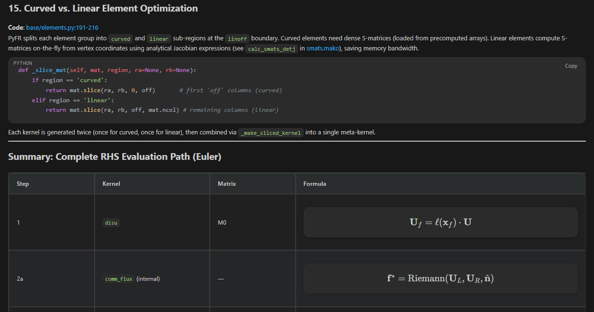

# Claude Code Enhance

Claude Code Enhance is a local VS Code extension that improves the Claude Code chat webview.

Based on work from:
- [claude-code-enhance](https://github.com/Sophomoresty/claude-code-enhance)
- [claude-code-katex](https://github.com/MahammadNuriyev62/claude-code-katex)

It adds:

- LaTeX math rendering with KaTeX
- Syntax highlighting for code blocks
- Theme-aware output styling for light, dark, and high-contrast themes
- More readable prompt/input text
- Copy buttons for assistant output and individual code blocks
- Structured, theme-aware API error cards
- Table and code-block readability improvements
- Ctrl/Cmd + mouse-wheel zoom for the chat output
- Configurable content/math scale and optional full-transcript retention
- A native sub-agent sidebar with complete, live child transcripts

## Preview

Original Claude Code output:


Enhanced output with Claude Code Enhance:



## Usage Guide

### LaTeX Math Rendering

The extension renders LaTeX math in Claude Code's responses using KaTeX. Four delimiter styles are supported:

| Delimiter | Mode | Example |
|---|---|---|
| `$...$` | Inline math | `The gradient $\nabla f(x)$ is computed via autodiff.` |
| `$$...$$` | Display math | `$$\int_0^\infty e^{-x^2} dx = \frac{\sqrt{\pi}}{2}$$` |
| `\(...\)` | Inline math | `The matrix \(A \in \mathbb{R}^{m \times n}\) has rank \(r\).` |
| `\[...\]` | Display math | `\[\mathbf{n}_{\text{phys}} = \mathbf{S}^T \cdot \mathbf{n}_{\text{ref}}\]` |

**Display math** renders as a centered, full-width block with a themed background and larger type. **Inline math** renders within the text flow with subtle background shading. Both sizes follow the `mathScale` setting.

**Smart math detection** — the enhancer uses heuristics to avoid rendering prose text as math. It detects CJK characters, prose punctuation, word density, and markdown emphasis patterns to decide whether a `$...$` span is actually LaTeX. False positives (KaTeX error spans in prose) are automatically cleaned up.

**Standalone math promotion** — when an inline math expression is the only content on its line (or the only content in its paragraph), it is automatically promoted to display math with the full block treatment.

**Large inline math** — inline expressions containing matrices (`\begin{matrix}`), fractions (`\frac`), or square roots (`\sqrt`) that exceed 34px in height or 58% of container width get a special `ce-large-inline-math` class with expanded padding and horizontal scroll.

**LaTeX in HTML** — when Claude Code's markdown parser splits math expressions with HTML tags (e.g., `$a_<em>i</em>$`), the enhancer repairs these by linearizing the DOM and restoring the original LaTeX before rendering.

**Escaped delimiters** — delimiters preceded by an odd number of backslashes (e.g. `\$not math\$`) are left as literal text.

Math inside inline code (`` `...` ``) and fenced code blocks is left as literal text.

### Syntax Highlighting

Code blocks are highlighted with bundled Highlight.js with a custom One Dark / One Light inspired syntax palette:

- **Labeled fences** — `` ```python ``, `` ```typescript ``, `` ```bash ``, `` ```latex `` and more are highlighted with language-specific grammar. Aliases are recognized: `js`→javascript, `ts`→typescript, `py`→python, `sh/bash/shell/zsh`→bash, `yml`→yaml, `md`→markdown, `tex`→latex.
- **Unlabeled fences** — blocks without a language tag default to `markdown` highlighting with colored prose, stronger heading colors, and distinct link/code/list-marker styles. This avoids the random auto-detection problem where unlabeled code gets guessed as `java`, `css`, `ini`, etc.
- **Unsupported languages** — blocks with languages Highlight.js does not recognize fall back to plain text styling with a language label instead of throwing errors.

The syntax palette maps 14 semantic token types (keywords, strings, numbers, comments, types, functions, etc.) to theme-aware CSS variables that adapt automatically across light, dark, and high-contrast themes.

### Copy Buttons

Two types of copy buttons are added:

**Per-code-block copy** — each `<pre>` block gets a **Copy** button at the top-right corner. Click copies the code block's raw text content. The button shows "Copied" for 1.4 seconds on success, or "Failed" on error.

**Per-turn copy** — each assistant message turn gets a **Copy** button at the bottom-right corner (visible on hover). Click copies the entire conversation turn as Markdown:
- KaTeX expressions are converted back to `$...$` or `$$...$$` delimited LaTeX
- Headings, lists, tables, code blocks, links, blockquotes are preserved as proper Markdown
- **Thinking content** (reasoning blocks) and **tool use/results** are excluded from the copy
- User messages are excluded from the copy

### Zoom

Hold **Ctrl** (or **Cmd** on macOS) and scroll with the mouse wheel to zoom the chat output:

- **Zoom range**: 0.5× to 2.0× in 0.1× increments
- A temporary zoom indicator appears in the center of the screen showing the current level (fades out after 1 second)
- Zoom level is persisted in `localStorage` under the key `claude-zoom` and survives webview reloads
- Zoom affects only the chat output (enhancement roots), not the entire webview or the chat input

### Relaxed Bold Rendering

Claude Code's Markdown parser follows CommonMark, which does not recognize bold markers with inner spaces: `** bold text **` appears as literal asterisks. The enhancer detects and renders these as `<strong>` elements. This only applies within prose text — code blocks, math expressions, and the chat input are left unchanged.

### Table Styling

Tables receive theme-aware styling:
- Full-width layout with 0.95em font size
- Rounded corners (12px border-radius)
- Themed background with subtle shadow
- Header row with distinct background color
- Zebra striping on alternating rows
- Row hover highlight
- Thin themed scrollbar for overflow tables
- Code within table cells is styled consistently

### Input & Prompt Readability

The enhancer forces VS Code theme colors on the chat input and textarea elements, ensuring:
- Input text color matches VS Code editor foreground
- Placeholder text matches VS Code placeholder foreground
- Caret color matches VS Code editor cursor color
- Text fill color is explicitly set to prevent CSS specificity issues

### Rich Editor Protection

The chat composer uses `contenteditable` and `[role="textbox"]` elements. The enhancer explicitly resets all code block styling on these elements (borders, padding, background, whitespace) so preview styles do not leak into the editing surface.

### Sub-agent Transcript Sidebar

The Claude Code activity-bar view exposes child-agent histories that the main Claude conversation normally summarizes. It reads Claude's existing files from `~/.claude/projects/<project>/<session>/subagents/agent-*.jsonl` and groups them by project and parent session. History files are read-only and are never rewritten.

Selecting a child agent opens its complete transcript in a separate live webview. The view includes:

- Full user, assistant, thinking, tool-call, and tool-result records
- Search plus answer, thinking, tool, and error filters
- GFM tables and fenced code through the bundled Marked parser
- KaTeX formulas protected before Markdown tokenization, including formulas inside tables
- Syntax highlighting and copy controls for code and tool output
- Structured tool/API errors and an option to open the original JSONL
- Append-only refresh while Claude is writing new records

Raw HTML in transcript text is displayed literally. Rendered Markdown is DOM-sanitized, links are protocol-restricted, and the webview uses a nonce-based Content Security Policy. If KaTeX rejects malformed or unsupported input, the original formula remains visible with an error tooltip.

### Status Bar Indicator

A status bar item (right-aligned) shows the current state:

| Indicator | Meaning |
|---|---|
| `LaTeX` (with operator symbol) | Enhancement patch is active and requested full history is verified |
| `LaTeX (off)` | Patch is not applied |
| `LaTeX` (with warning symbol) | Patch is incomplete, or full history safely fell back to Claude's native retention |
| `LaTeX (no CC)` | Claude Code extension is not installed |

Click the status bar item to run the status command, which reports the current patch state in detail.

### DOM Inspector (Hidden Debug Tool)

Press **Ctrl+Shift+D** inside the Claude Code webview to dump the DOM structure to your clipboard as JSON. This includes:
- Runtime configuration and rendering/scheduler diagnostics
- All unique class names in the document
- Elements matching 14 message-related selector patterns
- Root element structure analysis (up to 4 levels deep)
- Text-containing containers (> 200 characters)
- A green "Copied" notification confirms success

## Version

Current local version: `1.0.9`

The package version, internal patch build, and normalized configuration hash are stamped separately. A rebuild can therefore refresh stale injected code or settings without depending on a specific Claude Code version.

## Requirements

- VS Code or code-server
- The official `anthropic.claude-code` extension installed
- This VSIX installed from the local build output

## Install

From this directory:

```bash
npm run package
code --install-extension claude-code-enhance-1.0.9.vsix --force
```

Reload VS Code after installing. The extension patches Claude Code automatically on startup and reloads the Claude Code webview when it applies or refreshes the patch.

## Commands

Open the command palette with `Ctrl+Shift+P`:

- `Claude Code Enhance: Enable`
- `Claude Code Enhance: Disable`
- `Claude Code Enhance: Status`
- `Claude Code Enhance: Show Diagnostics`
- `Claude Code Enhance: Open Sub-agent Sidebar`
- `Claude Code Enhance: Show All Projects`
- `Claude Code Enhance: Show Active Workspace`
- `Claude Code Enhance: Open Raw Sub-agent Transcript`
- `Claude Code Enhance: Refresh Sub-agents`

## Settings

| Setting | Default | Purpose |
|---|---:|---|
| `claudeCodeEnhance.fullTranscript` | `true` | Keep the full conversation data instead of applying Claude Code's retention cap. The main chat renders only a virtualized turn window. |
| `claudeCodeEnhance.virtualTurns` | `true` | Render a tail-first virtual window while keeping the latest turn mounted. Disable `fullTranscript` before disabling this setting. |
| `claudeCodeEnhance.contentScale` | `1.1` | Scale rendered conversation content (`0.8`-`1.5`). |
| `claudeCodeEnhance.mathScale` | `1.0` | Additional inline/display math scale (`0.8`-`1.6`). |
| `claudeCodeEnhance.toolOutputMath` | `true` | Render validated math in prose-oriented tool output while preserving code regions. |
| `claudeCodeEnhance.syntaxHighlighting` | `true` | Apply bundled syntax highlighting. |
| `claudeCodeEnhance.copyButtons` | `true` | Add code-block and assistant-turn copy controls. |
| `claudeCodeEnhance.apiErrorCards` | `true` | Render API errors as structured diagnostic cards. |
| `claudeCodeEnhance.subagentProjectsRoot` | empty | Override the Claude history root used by the sub-agent sidebar; empty uses `~/.claude/projects`. The sidebar initially filters that root to the active workspace. |

Setting changes are normalized, hashed into the patch stamp, and applied by a guarded webview refresh.

## What Gets Patched

Claude Code Enhance does not modify Claude Code's extension host code. It patches only Claude Code's webview files:

- `webview/index.js`
- `webview/index.css`

Before patching, it creates backups:

- `webview/index.js.katex-bak`
- `webview/index.css.katex-bak`
- `webview/.claude-enhance-backup.json`

Patch, refresh, restore, and uninstall operations share an atomic cross-process lock. Backup rotation compares Claude version and pristine JS/CSS hashes, so a same-version repack cannot leave a stale restore point. Legacy backups without metadata are restored only after they are verified against a pristine webview and migrated to hash metadata.

The extension discovers the Markdown renderer and transcript-retention function through an Acorn syntax tree rather than a version-specific minified-code string. Both the legacy slice-based retention function and the newer structured message-list retention function are recognized. When `fullTranscript` is enabled, a missing or ambiguous retention target fails closed instead of silently claiming that complete history is active. JS/CSS updates use verified temporary files, `fsync`, atomic renames, and rollback; backup metadata records Claude's version and SHA-256 hashes.

The retention patch disables only Claude Code's capacity-based history trimming. Claude's semantic cleanup of explicitly superseded or retracted messages remains active so the main chat does not reintroduce duplicate or withdrawn rows.

For the installed Claude Code 2.1.314, 2.1.317, and 2.1.318 bundles, the capacity entry points are `BKe`, `tGe`, and `oGe`. Their replay/append wrappers (`zfe`/`Hfe`, `$fe`/`jfe`, and `qfe`/`Kfe`) call those entry points and inherit the patch automatically. Semantic cleanup (`Xhe`/`IKe`, `ope`/`$Ke`, and `spe`/`KKe`) is intentionally left unchanged. Minified names are diagnostic examples only; matching is structural and fails closed when the shape is missing or ambiguous.

Long conversations use a tail-first virtual turn window. Complete message data remains available, but only the active window plus the newest turn are mounted in the main chat. Moving the window preserves a keyed scroll anchor, so reading older history does not jump or pull back to streaming output. When both `fullTranscript` and `virtualTurns` are enabled, a future Claude bundle must match both the retention and turn-list signatures; otherwise only full-transcript retention is skipped and Claude's native retention remains active. Markdown, math, highlighting, and any independently verified virtualization patch still apply.

The status command and diagnostics distinguish requested settings from effective settings. If runtime virtualization unexpectedly fails after a verified patch, the message list falls back to a bounded recent-turn window instead of mounting the complete retained history.

`fullTranscript` controls the Webview's retained message data. It does not force Claude's model backend to resend every historical token; server-side context compaction and summarization remain Claude Code behavior.

The sub-agent sidebar does not patch Claude Code. It runs in this extension's host process and reads the public JSONL history layout, so its project/session/agent view is independent of Claude Code's minified webview bundle. Discovery starts only when the view becomes visible, uses up to 128 filesystem watchers with a 45-second fallback, and streams JSONL in fixed byte ranges and 300-message Webview batches. Cursor-tail validation detects same-inode rewrites before append mode is used. The extension host retains only the file cursor and metadata; the Webview retains complete message data behind a 100-node DOM cap.

## How Rendering Works

The extension injects `remark-math` and `rehype-katex` into Claude Code's Markdown rendering pipeline. Math is parsed before Markdown emphasis and escaping can damage LaTeX, so expressions like these render correctly:

```tex
$\mathbf{n}_{\text{phys}} = \mathbf{S}^T \cdot \mathbf{n}_{\text{ref}}$
$J^{-1} = S/|J|$
$$\tilde{F}_{ij} = \sum_k S^{\xi_i}_k \cdot F_{kj}$$
```

The bundled `enhance.js` also runs inside the webview to improve output styling, copy behavior, zoom, tables, code blocks, API errors, and fallback math rendering. A shared feature registry processes dirty message roots once per animation frame; conversation-container replacement is the deliberate full-pass fallback.

For long sessions, copy-button maintenance is scoped to changed turns, off-screen historical turns use `content-visibility`, and expensive math, API-error, and code enhancement waits until the affected message is near the viewport and quiet for a short period. Code highlighting uses size-aware limits: medium and large streaming blocks wait longer for a quiet period, while blocks above 500 KB stay plain text with copy support. Per-feature diagnostics include total, maximum, and latest processing time plus processed-root counts.

With `virtualTurns` enabled, Claude's message arrays stay complete while only the active turn window is mounted. The sub-agent transcript viewer uses the same data-versus-DOM separation: filtering and search run in cancellable idle slices against complete message records, while only 60-100 nearby messages are mounted with measured spacer heights. Same-file full reloads preserve a message-key scroll anchor instead of relying only on an estimated absolute offset. If `fullTranscript=true` is combined with `virtualTurns=false`, the extension keeps Claude's native retention cap instead of creating an unbounded full-DOM transcript.

Browser `Ctrl+F` searches only mounted turns. Claude's own message focus/highlight path can reveal an unmounted historical turn, but a separate full-history search index is not included. Claude still performs linear message-key, grouping, and turn-building work before the virtual DOM boundary; those data-layer paths remain unpatched because they are less expensive and materially more version-sensitive than the React/DOM work removed here.

## Theme Behavior

The enhancer uses VS Code theme variables where possible:

- editor foreground/background
- input foreground/background
- widget borders
- text code block background
- inline and display math background
- button colors
- high-contrast borders

Light theme code blocks use the One Light inspired palette so the dark bundled syntax theme does not produce low-contrast text.

## Disable Or Uninstall

Preferred temporary disable:

1. Run `Ctrl+Shift+P`.
2. Select `Claude Code Enhance: Disable`.
3. The extension restores the original webview files and reloads the webview.

To re-enable, run:

```text
Claude Code Enhance: Enable
```

Uninstalling the VS Code extension should run `uninstall-hook.js`, which restores every discovered Claude Code installation with verified backups and removes only `webview/claude-enhance-fonts`. Claude Code's own `webview/fonts` directory is never removed.

## If You Disabled The Extension From The Extensions Panel

VS Code's extension disable action does not run cleanup hooks. If you disabled the extension from the Extensions panel before running `Claude Code Enhance: Disable`, the already-patched Claude Code webview may keep the enhancement.

Use one of these fixes:

1. Re-enable `Claude Code Enhance`, then run `Claude Code Enhance: Disable`.
2. Or run the restore hook manually from this source directory:

```bash
npm run restore
```

Then reload the Claude Code webview or reload the VS Code window.

## Development

Run the dependency-free smoke test:

```bash
npm test
```

Run the focused sub-agent parser/renderer regression, including every local child-agent JSONL file:

```bash
npm run test:subagents
```

Validate all local Claude and Codex JSONL histories (this scans several gigabytes on a typical development machine):

```bash
npm run test:history
```

Build a VSIX:

```bash
npm run package
```

The generated `.vsix` file is ignored by `.vscodeignore`, so rebuilding will not accidentally include an old VSIX inside a new VSIX.

## Important Notes

- Disable or uninstall older `claude-code-katex` builds before using this extension to avoid two patchers fighting over the same Claude Code webview files.
- If Claude Code changes its internal webview bundle, the patch may become unsupported. In that case the extension leaves Claude Code untouched and shows a warning.
- This is a local enhancement extension, not an official Anthropic extension.

## License

MIT — see [LICENSE](LICENSE)
