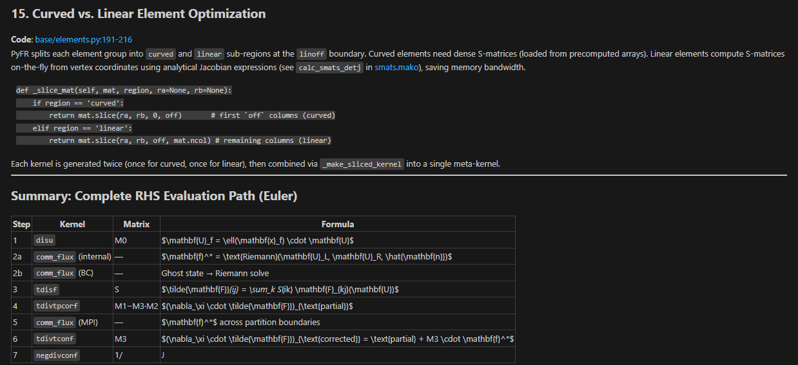

# Claude Code Enhance

Claude Code Enhance is a local VS Code extension that improves the Claude Code chat webview.

Based on work from:
- [claude-code-enhance](https://github.com/Sophomoresty/claude-code-enhance)
- [claude-code-katex](https://github.com/MahammadNuriyev62/claude-code-katex)

It adds:

- LaTeX math rendering with KaTeX
- Syntax highlighting for code blocks
- Theme-aware output styling for light, dark, and high-contrast themes
- More readable prompt/input text
- Copy buttons for assistant output and individual code blocks
- Structured, theme-aware API error cards
- Table and code-block readability improvements
- Ctrl/Cmd + mouse-wheel zoom for the chat output
- Configurable content/math scale, native chat retention, and searchable local conversation history
- A native sub-agent sidebar with complete, live child transcripts

## Preview

Original Claude Code output:



Enhanced output with Claude Code Enhance:


## Usage Guide

### LaTeX Math Rendering

The extension renders LaTeX math in Claude Code's responses using KaTeX. Four delimiter styles are supported:

| Delimiter | Mode | Example |
|---|---|---|
| `$...$` | Inline math | `The gradient $\nabla f(x)$ is computed via autodiff.` |
| `$$...$$` | Display math | `$$\int_0^\infty e^{-x^2} dx = \frac{\sqrt{\pi}}{2}$$` |
| `\(...\)` | Inline math | `The matrix \(A \in \mathbb{R}^{m \times n}\) has rank \(r\).` |
| `\[...\]` | Display math | `\[\mathbf{n}_{\text{phys}} = \mathbf{S}^T \cdot \mathbf{n}_{\text{ref}}\]` |

**Display math** renders as a centered, full-width block with a themed background and larger type. **Inline math** renders within the text flow with subtle background shading. Both sizes follow the `mathScale` setting.

**Smart math detection** — the enhancer uses heuristics to avoid rendering prose text as math. It detects CJK characters, prose punctuation, word density, and markdown emphasis patterns to decide whether a `$...$` span is actually LaTeX. False positives (KaTeX error spans in prose) are automatically cleaned up.

**Standalone math promotion** — when an inline math expression is the only content on its line (or the only content in its paragraph), it is automatically promoted to display math with the full block treatment.

**Large inline math** — inline expressions containing matrices (`\begin{matrix}`), fractions (`\frac`), or square roots (`\sqrt`) that exceed 34px in height or 58% of container width get a special `ce-large-inline-math` class with expanded padding and horizontal scroll.

**LaTeX in HTML** — when Claude Code's markdown parser splits math expressions with HTML tags (e.g., `$a_<em>i</em>$`), the enhancer repairs these by linearizing the DOM and restoring the original LaTeX before rendering.

**Escaped delimiters** — delimiters preceded by an odd number of backslashes (e.g. `\$not math\$`) are left as literal text.

Math inside inline code (`` `...` ``) and fenced code blocks is left as literal text.

### Syntax Highlighting

Code blocks are highlighted with bundled Highlight.js with a custom One Dark / One Light inspired syntax palette:

- **Labeled fences** — `` ```python ``, `` ```typescript ``, `` ```bash ``, `` ```latex `` and more are highlighted with language-specific grammar. Aliases are recognized: `js`→javascript, `ts`→typescript, `py`→python, `sh/bash/shell/zsh`→bash, `yml`→yaml, `md`→markdown, `tex`→latex.
- **Unlabeled fences** — blocks without a language tag default to `markdown` highlighting with colored prose, stronger heading colors, and distinct link/code/list-marker styles. This avoids the random auto-detection problem where unlabeled code gets guessed as `java`, `css`, `ini`, etc.
- **Unsupported languages** — blocks with languages Highlight.js does not recognize fall back to plain text styling with a language label instead of throwing errors.

The syntax palette maps 14 semantic token types (keywords, strings, numbers, comments, types, functions, etc.) to theme-aware CSS variables that adapt automatically across light, dark, and high-contrast themes.

### Copy Buttons

Two types of copy buttons are added:

**Per-code-block copy** — each `<pre>` block gets a **Copy** button at the top-right corner. Click copies the code block's raw text content. The button shows "Copied" for 1.4 seconds on success, or "Failed" on error.

**Per-turn copy** — each assistant message turn gets a **Copy** button at the bottom-right corner (visible on hover). Click copies the entire conversation turn as Markdown:
- KaTeX expressions are converted back to `$...$` or `$$...$$` delimited LaTeX
- Headings, lists, tables, code blocks, links, blockquotes are preserved as proper Markdown
- **Thinking content** (reasoning blocks) and **tool use/results** are excluded from the copy
- User messages are excluded from the copy

### Zoom

Hold **Ctrl** (or **Cmd** on macOS) and scroll with the mouse wheel to zoom the chat output:

- **Zoom range**: 0.5× to 2.0× in 0.1× increments
- A temporary zoom indicator appears in the center of the screen showing the current level (fades out after 1 second)
- Zoom level is persisted in `localStorage` under the key `claude-zoom` and survives webview reloads
- Zoom affects only the chat output (enhancement roots), not the entire webview or the chat input

### Relaxed Bold Rendering

Claude Code's Markdown parser follows CommonMark, which does not recognize bold markers with inner spaces: `** bold text **` appears as literal asterisks. The enhancer detects and renders these as `<strong>` elements. This only applies within prose text — code blocks, math expressions, and the chat input are left unchanged.

### Table Styling

Tables receive theme-aware styling:
- Full-width layout with 0.95em font size
- Rounded corners (12px border-radius)
- Themed background with subtle shadow
- Header row with distinct background color
- Zebra striping on alternating rows
- Row hover highlight
- Thin themed scrollbar for overflow tables
- Code within table cells is styled consistently

### Input & Prompt Readability

The enhancer forces VS Code theme colors on the chat input and textarea elements, ensuring:
- Input text color matches VS Code editor foreground
- Placeholder text matches VS Code placeholder foreground
- Caret color matches VS Code editor cursor color
- Text fill color is explicitly set to prevent CSS specificity issues

### Rich Editor Protection

The chat composer uses `contenteditable` and `[role="textbox"]` elements. The enhancer explicitly resets all code block styling on these elements (borders, padding, background, whitespace) so preview styles do not leak into the editing surface.

### Sub-agent Transcript Sidebar

The Claude Code activity-bar view exposes child-agent histories that the main Claude conversation normally summarizes. It reads Claude's existing files from `~/.claude/projects/<project>/<session>/subagents/agent-*.jsonl` and groups them by project and parent session. History files are read-only and are never rewritten.

Selecting a child agent opens its complete transcript in a separate live webview. The view includes:

- Full user, assistant, thinking, tool-call, and tool-result records
- Global file search plus answer, thinking, tool, and error filters, with paged result navigation
- GFM tables and fenced code through the bundled Marked parser
- KaTeX formulas protected before Markdown tokenization, including formulas inside tables
- Syntax highlighting and copy controls for code and tool output
- Structured tool/API errors and an option to open the original JSONL
- Incremental file indexing while Claude is writing new records; follow new messages at the tail, or retain your older page while reading

`Claude Code Enhance: Open Conversation History` provides a paged viewer for local main-session JSONL history. Main and sub-agent histories share the sparse index and global file search service. Each loaded page contains at most 60 messages; previous page bodies are released. Large pages are transmitted in batches targeting 512 KiB, with a Webview acknowledgement before the next batch. An individual record may exceed that target; no content is truncated to fit a transport batch.

Raw HTML in transcript text is displayed literally. Rendered Markdown is DOM-sanitized, links are protocol-restricted, and the webview uses a nonce-based Content Security Policy. If KaTeX rejects malformed or unsupported input, the original formula remains visible with an error tooltip.

### Status Bar Indicator

A status bar item (right-aligned) shows the current state:

| Indicator | Meaning |
|---|---|
| `LaTeX` (with operator symbol) | Enhancement patch is active; explicitly requested full history is verified but may cost more on long sessions |
| `LaTeX (off)` | Patch is not applied |
| `LaTeX` (with warning symbol) | Patch is incomplete, or full history safely fell back to Claude's native retention |
| `LaTeX (no CC)` | Claude Code extension is not installed |

Click the status bar item to run the status command, which reports the current patch state in detail.

### DOM Inspector (Hidden Debug Tool)

Press **Ctrl+Shift+D** inside the Claude Code webview to dump the DOM structure to your clipboard as JSON. This includes:
- Runtime configuration and rendering/scheduler diagnostics
- All unique class names in the document
- Elements matching 14 message-related selector patterns
- Root element structure analysis (up to 4 levels deep)
- Text-containing containers (> 200 characters)
- A green "Copied" notification confirms success

## Version

Current local version: `1.0.10`

The package version, internal patch build, and normalized configuration hash are stamped separately. A rebuild can therefore refresh stale injected code or settings without depending on a specific Claude Code version.

## Requirements

- VS Code or code-server
- The official `anthropic.claude-code` extension installed
- This VSIX installed from the local build output

## Install

From this directory:

```bash
npm run package
code --install-extension claude-code-enhance-1.0.10.vsix --force
```

Reload VS Code after installing. The extension patches Claude Code automatically on startup and reloads the Claude Code webview when it applies or refreshes the patch.

## Commands

Open the command palette with `Ctrl+Shift+P`:

- `Claude Code Enhance: Enable`
- `Claude Code Enhance: Disable`
- `Claude Code Enhance: Status`
- `Claude Code Enhance: Show Diagnostics`
- `Claude Code Enhance: Open Sub-agent Sidebar`
- `Claude Code Enhance: Show All Projects`
- `Claude Code Enhance: Show Active Workspace`
- `Claude Code Enhance: Open Conversation History`
- `Claude Code Enhance: Open Raw Sub-agent Transcript`
- `Claude Code Enhance: Refresh Sub-agents`

## Settings

| Setting | Default | Purpose |
|---|---:|---|
| `claudeCodeEnhance.fullTranscript` | `false` | Keep complete conversation data in Claude's main chat. This may reduce performance on long sessions; use Open Conversation History to browse complete local JSONL history. |
| `claudeCodeEnhance.virtualTurns` | `true` | Render a tail-first virtual window while keeping the latest turn mounted. If disabled while `fullTranscript=true`, the extension keeps Claude's native retention cap. |
| `claudeCodeEnhance.contentScale` | `1.1` | Scale rendered conversation content (`0.8`-`1.5`). |
| `claudeCodeEnhance.mathScale` | `1.0` | Additional inline/display math scale (`0.8`-`1.6`). |
| `claudeCodeEnhance.toolOutputMath` | `true` | Render validated math in prose-oriented tool output while preserving code regions. |
| `claudeCodeEnhance.syntaxHighlighting` | `true` | Apply bundled syntax highlighting. |
| `claudeCodeEnhance.copyButtons` | `true` | Add code-block and assistant-turn copy controls. |
| `claudeCodeEnhance.apiErrorCards` | `true` | Render API errors as structured diagnostic cards. |
| `claudeCodeEnhance.subagentProjectsRoot` | empty | Override the Claude history root used by the sub-agent sidebar and conversation-history viewer; empty uses `~/.claude/projects`. The sidebar initially filters that root to the active workspace. |

Rendering settings use the User/application scope because every window shares the same installed Claude patch. Existing explicit workspace values are migrated to User settings when no User value exists, including `fullTranscript=true`. Conflicts retain the User value and show a notice; workspace files are not rewritten. The history-root setting remains workspace configurable. Changes are normalized, hashed into the patch stamp, and applied by a guarded refresh.

## What Gets Patched

Claude Code Enhance patches these webview files:

- `webview/index.js`
- `webview/index.css`

When structurally identified, it also adds `blob:` to the extension host's Webview `worker-src` CSP template. This permits a bundled local Worker across VS Code's separate Webview/resource origins. The host change only changes this directive and requires **Reload Window** to activate or restore it. Missing or ambiguous templates are left untouched and reported in diagnostics.

Before patching, it creates backups:

- `webview/index.js.katex-bak`
- `webview/index.css.katex-bak`
- `webview/.claude-enhance-backup.json`
- `webview/claude-enhance-worker-policy.backup` and `webview/claude-enhance-worker-policy.json` when the host CSP is patched

Patch, refresh, restore, and uninstall operations share an atomic directory lock with unique owner records. Dead-owner recovery cannot remove a newer owner's lock. Patch construction, compatibility checks, and lock waits execute in a Node worker thread, keeping the extension-host event loop available. Backup rotation compares Claude version and pristine hashes, so a same-version repack cannot leave a stale restore point. Legacy backups without metadata are restored only after verification. Host CSP restoration verifies both original and patched hashes and refuses to overwrite an unexpectedly modified host entry.

The extension discovers the Markdown renderer and transcript-retention function through an Acorn syntax tree rather than a version-specific minified-code string. Both the legacy slice-based retention function and the newer structured message-list retention function are recognized. When `fullTranscript` is enabled, a missing or ambiguous retention target fails closed instead of silently claiming that complete history is active. JS/CSS updates use verified temporary files, `fsync`, atomic renames, and rollback; backup metadata records Claude's version and SHA-256 hashes.

By default the extension keeps Claude Code's native capacity-based history trimming, which avoids building and grouping an unbounded message model in the main chat. Setting `fullTranscript=true` disables only that capacity trimming; Claude's semantic cleanup of explicitly superseded or retracted messages remains active.

For the inspected Claude Code 2.1.314, 2.1.317, 2.1.318, 2.1.319, and 2.1.332 bundles, the capacity entry points are `BKe`, `tGe`, `oGe`, `wGe`, and `kj`. Their replay/append wrappers call those entry points and inherit the patch automatically. Semantic cleanup is intentionally left unchanged. Minified names are diagnostic examples only; matching is structural and fails closed when the shape is missing or ambiguous.

Claude Code 2.1.332 uses ES module syntax and `import.meta.url` to load math and Monaco assets. The patch supports both classic scripts and modules, preserves relative asset URLs, and isolates injected library bindings from Claude's bundle. Its native math provider and code renderer are recognized through their Markdown properties and parameter bindings. While enhancement is available, the verified provider hooks select the enhancer's math and highlighting paths, avoiding duplicate parsing and competing code-block DOM updates. Disabling enhanced syntax highlighting retains native code coloring; if the enhancement pipeline is unavailable, the original native settings remain effective. Diagnostics expose `sourceType`, `nativeMathGuarded`, and `nativeCodeGuarded`.

Long conversations use a tail-first virtual turn window. Only the active window plus the newest turn are mounted. When `fullTranscript` is left at its default `false`, Claude also keeps its native message-retention cap, avoiding the linear message-key, grouping, and turn-building work that occurs before the virtual DOM boundary. Turning `fullTranscript` on keeps complete message data in Claude's model and may bring back that cost.

The status command and diagnostics distinguish requested settings from effective settings. If runtime virtualization unexpectedly fails after a verified patch, the message list falls back to a bounded recent-turn window instead of mounting the complete retained history.

`fullTranscript` controls the Webview's retained message data. It does not force Claude's model backend to resend every historical token; server-side context compaction and summarization remain Claude Code behavior.

`Claude Code Enhance: Open Conversation History` opens a workspace-filtered selector for local Claude session JSONL files (or all local projects when no workspace is open). The viewer builds a sparse index in the extension host, loads only 60 messages per page, and scans the file on demand for case-insensitive literal search. The Webview holds only the current page and search-result snippets. Files are read-only; remote/cloud-only sessions are not available. Malformed and partial JSONL lines are reported, and records larger than 1 MiB use a lightweight placeholder with an option to open the raw file at that line.

Indexing, page reads, and search use a fixed file boundary, so appending new messages does not invalidate an in-progress read. File identity, size, timestamps, and a saved tail fingerprint detect replacement, truncation, and tail rewrites. New bytes are indexed incrementally, including a previously incomplete final line. Searches keep their original snapshot across batches; new messages are included when the query runs again. Results arrive in batches of 50, with at most 300 recent snippets mounted and a continuation button to reach later matches. JSONL scanning avoids copying each complete line and yields after 256 records or approximately 8 ms, whichever comes first, so cancellation can run between expensive records. The time budget is cooperative; one record can exceed it. Indexing only checks whether a record is displayable, and page reads format message bodies only inside the requested page, avoiding tool-input serialization for skipped records.

The history viewer keeps the current page, scroll position, and expanded content when new messages arrive. The Latest button shows the number of new messages and loads them on request, including updates to a partially filled last page. First, Older, Newer, and direct page-number navigation make distant history reachable without repeated paging. Collapsed thinking, tool calls, and long tool results build their rich content only when expanded; search navigation opens matching disclosures. Sub-agent live append behavior stays unchanged.

The sub-agent sidebar does not patch Claude Code. It runs in this extension's host process and reads the public JSONL history layout, so its project/session/agent view is independent of Claude Code's minified webview bundle. Discovery starts only when the view becomes visible, uses up to 128 filesystem watchers with a 45-second fallback, and streams JSONL in fixed byte ranges and 300-message Webview batches. Cursor-tail validation detects same-inode rewrites before append mode is used. The extension host retains only the file cursor and metadata; the Webview retains complete message data behind a 100-node DOM cap.

Transcript window updates leave overlapping message nodes connected and only insert or remove messages entering or leaving the window. Height-only refreshes preserve focus, text selection, and expanded disclosures without remounting messages or restarting their resize observation. Sub-agent search and filtering yield after 400 records or approximately 6 ms, including browsers without `requestIdleCallback`; a timed-out idle callback still makes bounded progress.

## How Rendering Works

The extension injects `remark-math` and `rehype-katex` into Claude Code's Markdown rendering pipeline. Math is parsed before Markdown emphasis and escaping can damage LaTeX, so expressions like these render correctly:

```tex
$\mathbf{n}_{\text{phys}} = \mathbf{S}^T \cdot \mathbf{n}_{\text{ref}}$
$J^{-1} = S/|J|$
$$\tilde{F}_{ij} = \sum_k S^{\xi_i}_k \cdot F_{kj}$$
```

The bundled `enhance.js` also runs inside the webview to improve output styling, copy behavior, zoom, tables, code blocks, API errors, and fallback math rendering. A shared feature registry processes dirty message roots once per animation frame; conversation-container replacement is the deliberate full-pass fallback.

For long sessions, copy-button maintenance is scoped to changed turns, off-screen historical turns use `content-visibility`, and expensive math, API-error, and code enhancement waits until the affected message is near the viewport and quiet for a short period. Streaming code above 51,200 JavaScript string units uses deferred highlighting after a 400–800 ms quiet period; smaller blocks retain the 120 ms rate limit. Size affects scheduling, not whether formatting is available.

Large or dense Markdown uses a progressive renderer in both main chat and transcript views. Source-size, line-count, and delimiter-density thresholds select this path; math-bearing sources above 4,096 string units also qualify. Complete source and copying remain available. A local Worker retains the document tokens and reference definitions; appends re-lex the active final block, while reference-definition changes trigger a full re-lex. Completed blocks keep their DOM and newly streamed text appears immediately in a plain-text tail while formatting catches up. Continuous appends use a maximum scheduling delay of 750 ms, in addition to a 250 ms quiet period.

Messages above 96 semantic blocks mount a moving window of 32–64 blocks. Code and tables above 120 lines/rows mount at most 80 rows in an independently scrollable area; full code/table copying fetches the complete block. Tool code and standalone large code use the same renderer. Height estimates and measurements maintain spacers and reading anchors. Worker documents use a 16-document, approximately 32 MiB cache budget, evicting older documents that can be reconstructed from retained source. A single active document can exceed that budget to remain fully renderable. This is a cache estimate, not a JavaScript heap limit.

Giant paragraphs, individual code lines, and table cells use navigable fragments, typically around 8,192 text units. Fragmentation happens after semantic parsing and highlighting, preserving nested formatting and links. The viewer retains one fragment, or two adjacent fragments for a search spanning their boundary. **Previous fragment**, **Next fragment**, and **Show entire block** provide access to all content; complete expansion also supports continuous selection and reading. Source and copy controls remain complete. A larger individual token or grapheme can exceed the fragment target. Large formulas are split only where KaTeX provides complete top-level layout groups; full expansion preserves the original expression and MathML. Fractions, matrices, and other indivisible layouts remain intact.

Streaming JavaScript/TypeScript and JSON code reuse completed highlighted prefixes at verified root lexical boundaries. The active tail is reprocessed with its full context, retaining at least 1,024 characters of overlap. Multiline comments, strings, nested templates, and embedded languages are never split independently. The bundled Highlight.js 11.9.0 has a local opt-in checkpoint hook; this hook and its full-output equivalence tests must be retained or revalidated when updating that library. Other grammars, edits, and tails without a safe boundary retain full highlighting. Nested row and fragment positions survive append updates.

The main-chat renderer lives in a custom element's shadow tree; React continues owning its original source text. Main chat and history prefer a bundled Blob Worker when CSP permits it, with a sibling module Worker as an alternate asset. The CSP patch and Worker assets are restored or removed with the patch. Worker creation failure falls back to deferred main-thread processing; an individual parser/highlighter call can still block in this mode. Invalid content retains its source and interrupted formatting offers retry. Ordinary, transcript, and Worker mathematics share normalization, macro repairs, validation, and bounded prepared-output caching. KaTeX retains `trust:false`, bounded expansion, and bounded sizing. The history service's separate 1 MiB raw-record policy is unchanged.

DOM construction yields cooperatively after about 6 ms or 200 nodes. Diagnostics report Worker/fallback backend, cancellation, cache estimates, block reuse, DOM slices, and observed long tasks without recording message contents. Fragmentation bounds the common mounted text/layout path; initial Markdown, KaTeX, and highlighting calls still process the complete semantic unit in the Worker. Indivisible formulas and explicitly expanded blocks can still require large layouts, and source/token memory scales with an active message. There is no hard frame-time or constant-memory guarantee. Giant messages use the viewer's safe Markdown dialect, so Claude-specific Markdown components and application links are not reproduced there.

With `virtualTurns` enabled, only the active turn window is mounted; Claude's message data follows native retention by default and stays complete only when `fullTranscript=true` is explicitly enabled. Both history viewers retain one 60-message page and use cancellable host file scans for global searches and filters. The Webview does not accumulate complete sub-agent histories or lowercase search copies. Appends update sparse checkpoints and metadata; the sub-agent viewer follows the tail only while the reader remains there and no search is active. If `fullTranscript=true` is combined with `virtualTurns=false`, the extension keeps Claude's native retention cap.

Browser `Ctrl+F` searches mounted content, including only mounted blocks/rows/fragments inside a giant message. Complete-source disclosures and copying remain available. Claude's own message focus/highlight path can reveal an unmounted turn. Local history search returns the displayed content-block index and UTF-16 source offsets, then opens the matching disclosure, block window, row, and fragment. The matching text is highlighted; Markdown syntax or formula-source matches use the complete-source disclosure when they cannot be represented as rendered text. Oversized JSONL records open at their raw line. Search is literal with locale-independent Unicode lowercase and Greek final-sigma normalization. Remote/cloud-only sessions remain outside this local viewer. Claude still performs linear message-key, grouping, and turn-building work before the virtual DOM boundary when `fullTranscript=true`; those data-layer paths remain unpatched.

## Theme Behavior

The enhancer uses VS Code theme variables where possible:

- editor foreground/background
- input foreground/background
- widget borders
- text code block background
- inline and display math background
- button colors
- high-contrast borders

Light theme code blocks use the One Light inspired palette so the dark bundled syntax theme does not produce low-contrast text.

## Disable Or Uninstall

Preferred temporary disable:

1. Run `Ctrl+Shift+P`.
2. Select `Claude Code Enhance: Disable`.
3. The extension restores the original webview files and reloads the webview.

To re-enable, run:

```text
Claude Code Enhance: Enable
```

Uninstalling the VS Code extension should run `uninstall-hook.js`, which restores every discovered Claude Code installation with verified backups and removes only `webview/claude-enhance-fonts`. Claude Code's own `webview/fonts` directory is never removed.

## If You Disabled The Extension From The Extensions Panel

VS Code's extension disable action does not run cleanup hooks. If you disabled the extension from the Extensions panel before running `Claude Code Enhance: Disable`, the already-patched Claude Code webview may keep the enhancement.

Use one of these fixes:

1. Re-enable `Claude Code Enhance`, then run `Claude Code Enhance: Disable`.
2. Or run the restore hook manually from this source directory:

```bash
npm run restore
```

Then reload the Claude Code webview or reload the VS Code window.

## Development

Run the dependency-free smoke test:

```bash
npm test
```

Run the focused sub-agent parser/renderer regression, including every local child-agent JSONL file:

```bash
npm run test:subagents
```

Run the Chromium browser regressions:

```bash
npm run test:browser
```

These exercise the production transcript HTML and CSP with 10,000+ synthetic messages, page limits and jumps, scrolling, search continuation, lazy disclosures, reading-position preservation during appends, and Markdown sanitization. They also load patched classic-script and ES-module fixtures with the real vendor runtime, checking math fallback, highlighting, relative lazy imports, and exact restoration. An enhancement scheduler test verifies that simulated expensive blocks yield across animation frames and detached roots are discarded. Installed-bundle structural and patch/restore checks run in `npm test` using temporary copies. These automated checks do not replace a manual test inside the VS Code Webview.

Validate all local Claude and Codex JSONL histories (this scans several gigabytes on a typical development machine):

```bash
npm run test:history
```

Build a VSIX:

```bash
npm run package
```

The generated `.vsix` file is ignored by `.vscodeignore`, so rebuilding will not accidentally include an old VSIX inside a new VSIX.

## Important Notes

- Disable or uninstall older `claude-code-katex` builds before using this extension to avoid two patchers fighting over the same Claude Code webview files.
- If Claude Code changes its internal webview bundle, the patch may become unsupported. In that case the extension leaves Claude Code untouched and shows a warning.
- This is a local enhancement extension, not an official Anthropic extension.

## License

MIT — see [LICENSE](LICENSE)
